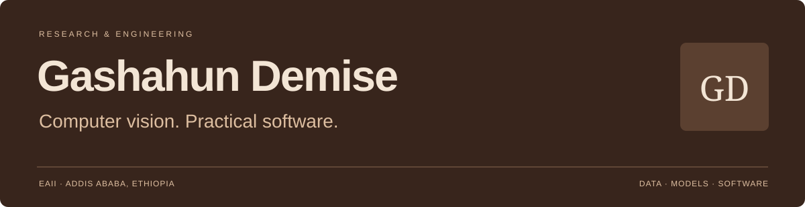

  
    
  
  
  
  

## Research curiosity. Engineering discipline.

I'm **Gashahun Demise**, a **Computer Vision Researcher at the Ethiopian Artificial Intelligence Institute (EAII)**. I work on agricultural image understanding, annotation pipelines, and dataset quality, with a focus on careful evaluation and practical deployment.

My background is in **Electrical and Computer Engineering**. I also build APIs and web applications that connect technical systems with usable interfaces.

| Background | |
| :--- | :--- |
| **Current role** | Computer Vision Researcher, EAII · July 2025–present |
| **Education** | B.Sc. Electrical & Computer Engineering, Addis Ababa Science and Technology University · 2025 |
| **Certification** | Deep Learning for Computer Vision, WorldQuant University |
| **Based in** | Addis Ababa, Ethiopia |

## What I focus on

**Data before models** — class taxonomies, labeling guidelines, image annotation, label correction, and QA. My work includes YOLO, COCO, and Pascal VOC dataset formats.

**Evaluation beyond one score** — transfer learning, classification and segmentation, per-class behavior, confusion matrices, and error analysis.

**Research into usable systems** — TensorFlow Lite, resource-aware deployment, Python APIs, and clear frontend experiences.

## Selected work

<table>
<tr>
<td width="50%" valign="top">
<h3><a href="https://github.com/gashahundemise21/saasforge">SaaSForge ↗</a></h3>

A multi-tenant B2B software foundation with organization context, authentication, API services, and database migrations.

<code>Python</code> <code>FastAPI</code> <code>Next.js</code> <code>PostgreSQL</code>

<strong>Public implementation</strong> · <a href="https://gashahun-demise-portfolio.vercel.app/projects/saasforge">Engineering notes</a>

</td>
<td width="50%" valign="top">
<h3><a href="https://github.com/gashahundemise21/task-board-app">TaskFlow ↗</a></h3>

A focused Kanban interface with task editing, search/filter controls, status changes, and component tests.

<code>React</code> <code>TypeScript</code> <code>Vite</code> <code>Vitest</code>

<strong>Public implementation</strong> · <a href="https://gashahun-demise-portfolio.vercel.app/projects/taskflow">Project notes</a>

</td>
</tr>
<tr>
<td width="50%" valign="top">
<h3><a href="https://gashahun-demise-portfolio.vercel.app/projects/enset">AgriScan / Enset research ↗</a></h3>

Enset leaf disease classification, dataset preparation, model evaluation, and TensorFlow Lite optimization, as described in my resume.

<code>TensorFlow</code> <code>OpenCV</code> <code>TensorFlow Lite</code>

<strong>Ongoing research</strong> · The <a href="https://github.com/gashahundemise21/Enset-Disease-Guard-EdgeAI">public repository</a> is currently a scaffold.

</td>
<td width="50%" valign="top">
<h3><a href="https://gashahun-demise-portfolio.vercel.app/">Professional portfolio ↗</a></h3>

A responsive portfolio with source-backed project notes, a downloadable resume, accessibility features, SEO, and visitor analytics.

<code>Next.js</code> <code>TypeScript</code> <code>Vercel</code>

<strong>Live deployment</strong> · <a href="https://github.com/gashahundemise21/gashahun-demise-portfolio">Source code</a>

</td>
</tr>
</table>

## Technical toolkit

### Machine learning & computer vision

      

### Applications & data

     

### Deployment & engineering tools

   

Additional experience: **C/C++, SQL, REST APIs, and CI/CD**.

## How I approach engineering

- Establish the data quality and split strategy before interpreting model results.
- Examine failure cases and per-class behavior alongside aggregate metrics.
- Keep experiments understandable and software modular.
- Consider latency, memory, and deployment constraints alongside model performance.

## Let's build something useful

I'm interested in **computer vision research, machine learning engineering, and practical software projects**. For collaborations or opportunities, explore my work and get in touch.

**[Portfolio](https://gashahun-demise-portfolio.vercel.app/)** · **[Resume](https://gashahun-demise-portfolio.vercel.app/resume/gashahun-demise-resume.pdf)** · **[LinkedIn](https://www.linkedin.com/in/gashahun-demise/)** · **[gashahundemise21@gmail.com](mailto:gashahundemise21@gmail.com)**

---

Research-minded. Engineering-focused. Built around real work.
